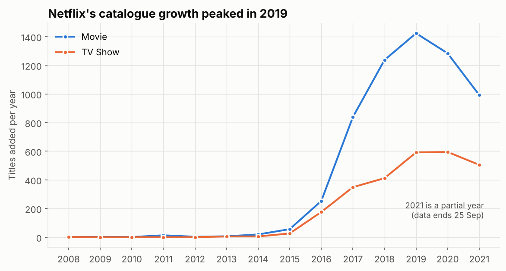

# Netflix Content Analysis

An end-to-end exploratory data analysis of **8,807 Netflix titles** (6,131 movies and 2,676 TV shows, added between 2008 and 25 Sep 2021). The project cleans the raw data, answers questions about how the catalogue is built and how it has grown, tests three patterns statistically, mines the title descriptions for themes, and ends with a small content-based recommender.



## Key findings

| # | Finding | Evidence |
|---|---------|----------|
| 1 | **Movies make up 69.6% of the catalogue**, TV shows 30.4%. | 6,131 vs 2,676 titles |
| 2 | **Growth was sudden.** Only 138 titles had been added by the end of 2015; 81.4% of titles with an added date arrived between 2016 and 2020. 2019 was the peak year (2,016 titles). Movie additions peaked in 2019 (1,424), TV additions in 2020 (595). | `02_additions_by_year.png` |
| 3 | **The catalogue is recent.** The median movie reaches Netflix 2 years after release, the median TV show in the same year it was released. | `03`, `14` |
| 4 | **The US leads, India is second.** US 3,690 titles, India 1,046, UK 806, Canada 445, France 393. About 46% of titles with a country listed involve the US. | `05_top_countries.png` |
| 5 | **Countries have distinct profiles.** India's catalogue is 92% movies (962 of 1,046). South Korea (74% TV) and Japan (63% TV) lean to series. | `08_country_genre_heatmap.png` |
| 6 | **Drama and comedy dominate movies;** TV is led by International TV Shows (1,351) and TV Dramas (763). | `06`, `07` |
| 7 | **Adult content is the largest audience slice.** TV-MA (3,207) and TV-14 (2,160) are the top ratings. Adult-rated titles are about 44–48% of rated additions in every year since 2016. | `09`, `10` |
| 8 | **Movies run about 98 minutes at the median** and have got shorter: the median was about 108 min for 2000s releases and 97 min for 2010s releases. Spearman rho between release year and runtime is -0.19. | `11_movie_runtime.png` |
| 9 | **Most TV shows are one-season shows:** 67.0% have a single season (max 17). | `12_tv_seasons.png` |
| 10 | **Descriptions fall into eight themes,** from family and coming-of-age stories to war documentaries and stand-up comedy. | `17_description_topics.png` |

All numbers are computed by the code and saved in [`reports/metrics.json`](reports/metrics.json) and [`reports/tables/`](reports/tables/).

## Statistical tests

| Question | Test | Result |
|----------|------|--------|
| Has movie runtime changed with release year? | Spearman correlation | rho = -0.19, p < 1e-50 (weak negative) |
| Are adult-rated movies longer than kids/family movies? | Mann-Whitney U | medians 98 vs 90 min, p < 1e-43 (small gap) |
| Is content type linked to maturity rating? | Chi-square | Cramér's V = 0.16 (modest association) |

With thousands of rows almost any difference is "significant", so the effect sizes matter more than the p-values.

## Project structure

```
netflix-content-analysis/
├── README.md                  <- you are here
├── LICENSE                    <- MIT
├── requirements.txt           <- runtime dependencies
├── requirements-dev.txt       <- + notebook and test tools
├── .gitignore
├── main.py                    <- runs the whole pipeline
├── data/
│   ├── raw/netflix_data.csv   <- original data, never edited
│   └── processed/             <- cleaned CSV is written here (git-ignored)
├── src/
│   ├── cleaning.py            <- load, fix and enrich the data
│   ├── analysis.py            <- every table, statistic and text model
│   ├── plots.py               <- the 17 figures
│   └── recommender.py         <- TF-IDF content-based recommender
├── notebooks/
│   └── 01_netflix_analysis.ipynb   <- narrated walkthrough with outputs
├── reports/
│   ├── metrics.json           <- headline numbers and test results
│   ├── figures/               <- 17 PNG charts
│   └── tables/                <- 10 CSV result tables
├── tests/
│   └── test_cleaning.py       <- unit tests for the cleaning logic
└── .github/workflows/ci.yml   <- runs tests and the pipeline on every push
```

## Quick start

```bash
git clone https://github.com/<your-username>/netflix-content-analysis.git
cd netflix-content-analysis

python -m venv .venv
source .venv/bin/activate          # Windows: .venv\Scripts\activate
pip install -r requirements.txt

python main.py                     # cleans data, writes tables, figures and metrics
```

To explore interactively or run the tests:

```bash
pip install -r requirements-dev.txt
jupyter notebook notebooks/01_netflix_analysis.ipynb
pytest
```

## Method

1. **Clean** (`src/cleaning.py`): trim text, parse `date_added`, split `duration` into minutes (movies) and seasons (TV), repair 3 rows where the runtime was typed into the `rating` column, group ratings into Kids / Family / Teens / Adults / Unrated, and derive year, month, decade and "years between release and addition".
2. **Explore** (`src/analysis.py`): counts by type, year, month, country, genre, rating, runtime and people. List columns (country, genre, cast, director) are exploded so a title is counted once per item.
3. **Test**: Spearman, Mann-Whitney and chi-square tests with effect sizes.
4. **Text mining**: TF-IDF to find words that distinguish movies from TV shows, and an NMF topic model (8 topics) over descriptions.
5. **Recommend**: cosine similarity over TF-IDF of description, genres, cast and director.

## Data dictionary

| Column | Meaning |
|--------|---------|
| `show_id`, `title`, `description` | Identifier, name and Netflix's synopsis |
| `type` | Movie or TV Show |
| `director`, `cast`, `country`, `listed_in` | Comma-separated lists (`listed_in` = genres) |
| `date_added` | Date added to Netflix |
| `release_year` | Original release year |
| `rating` | Content rating (e.g. TV-MA, PG-13) |
| `duration` | "90 min" for movies, "2 Seasons" for TV |
| *Derived:* `year_added`, `month_added`, `years_to_netflix`, `release_decade`, `duration_min`, `n_seasons`, `rating_group`, `primary_country`, `primary_genre` | Added by `src/cleaning.py` |

**Data source:** the file appears to be the widely used public Kaggle dataset "Netflix Movies and TV Shows". Check the licence on the page you downloaded it from before redistributing the raw CSV.

## Limitations

* The data is a snapshot ending 25 Sep 2021 and has **no viewership, popularity or review scores**. It shows what is in the catalogue, not what people watch.
* 2021 is a partial year, so its decline in additions is partly an artefact.
* Director is missing for 29.9% of titles; country and cast for about 9.4% each. Those rows are excluded from the analyses that use them.
* Genres are Netflix's own tags; "International Movies" is a broad catch-all.
* The recommender is content-based only. Its suggestions are topically similar, not personalised.

## Ideas for next steps

* Join with IMDb ratings to ask whether catalogue mix relates to quality.
* Build a Streamlit dashboard on top of `src/analysis.py`.
* Forecast monthly additions with a time-series model.
* Replace TF-IDF with sentence embeddings in the recommender.

## License

MIT, see [LICENSE](LICENSE). Replace `[Your Name]` in the licence file with your own name before publishing.
